<p align="center">
  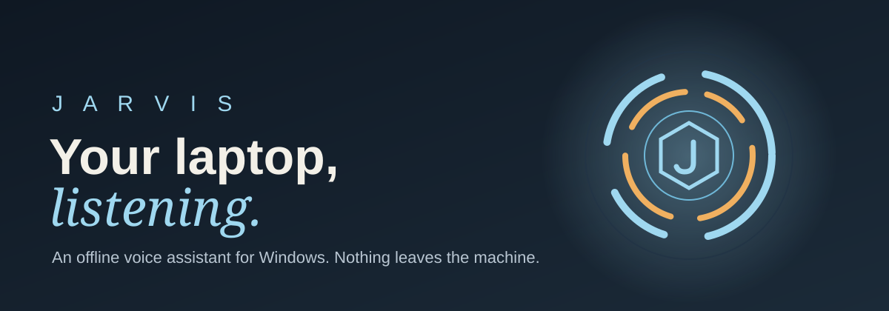
</p>

<p align="center">
  <b>An offline voice assistant for Windows.</b><br>
  Say "Jarvis". It opens, clicks, remembers, reminds and replies, in a calm British voice.<br>
  <i>Nothing ever leaves the laptop.</i>
</p>

<p align="center">
  
  
  
  
  
</p>

---

## What is Jarvis?

Jarvis is a hands-free assistant that runs **entirely on one laptop**: the listening, the understanding, the voice and the memory. No cloud, no account, no telemetry. It was built in nine days (31 Oct to 8 Nov 2026) by a first-time builder with an AI coding assistant doing all the typing, tested by living with it and reporting what felt wrong.

The aim was never "a chatbot". It was an assistant that **feels alive and smart**: it understands loose, mis-heard everyday speech, does the right small thing, tells the truth about whether it worked, and slowly learns your habits and words.

<p align="center">
  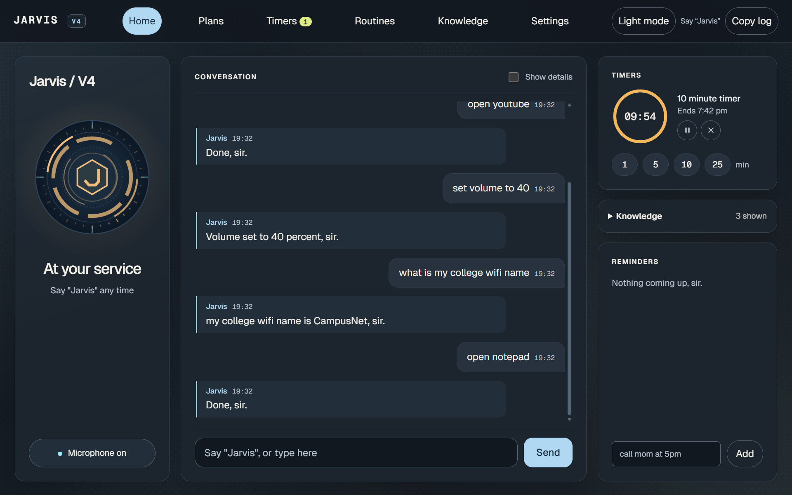
</p>

> The home screen. Left: the living reactor (it breathes at rest and reacts to your voice and to Jarvis's own). Middle: the conversation. Right: timers, reminders and a peek at Knowledge. Screenshots in this README are from a throw-away demo profile with made-up data.

---

## See it

<table>
<tr>
<td width="50%">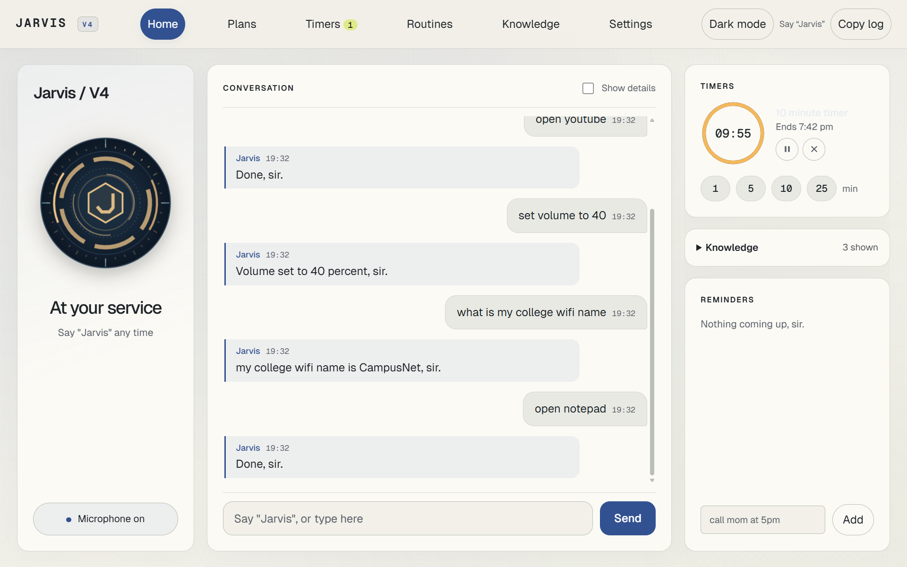<br><sub><b>Light and dark.</b> Same app, two themes, remembered between runs.</sub></td>
<td width="50%">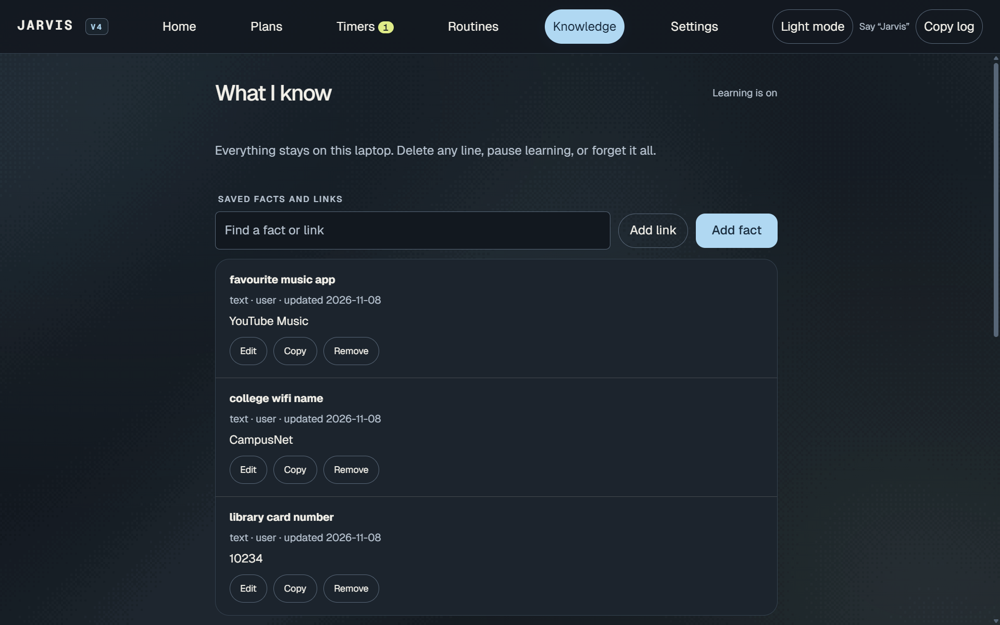<br><sub><b>Knowledge.</b> Everything Jarvis knows about you, in plain sight. Edit, copy, remove, pause learning, or forget it all.</sub></td>
</tr>
<tr>
<td width="50%">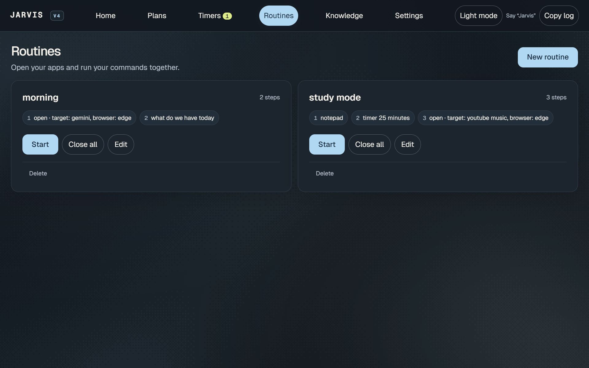<br><sub><b>Routines.</b> "Start study mode" opens your apps and sets your timer. "Close study mode" closes them again.</sub></td>
<td width="50%">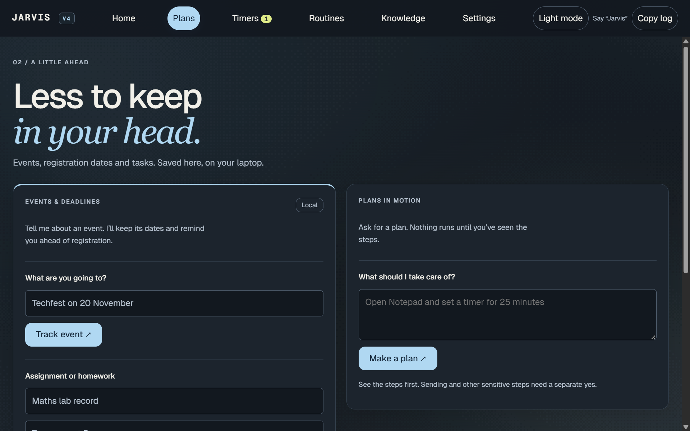<br><sub><b>Plans.</b> Events, deadlines and checked multi-step plans. Nothing runs until you have seen the steps.</sub></td>
</tr>
<tr>
<td width="50%">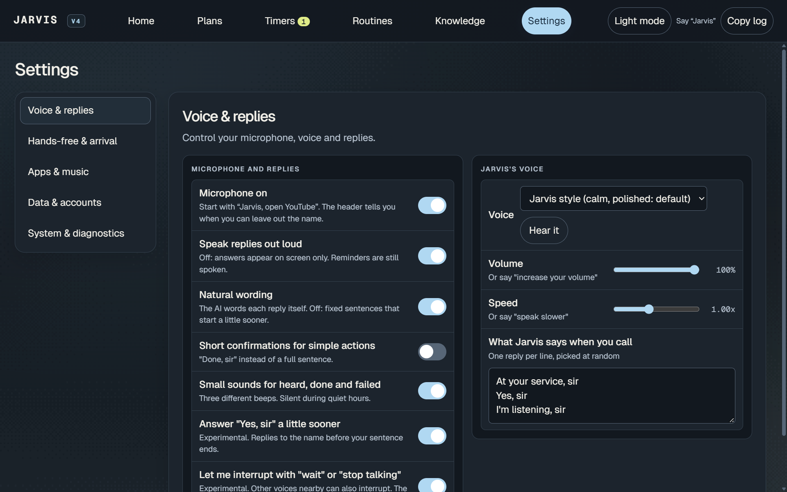<br><sub><b>Settings.</b> Plain-language switches in five groups. Voice, hands-free, apps, data, diagnostics.</sub></td>
<td width="50%">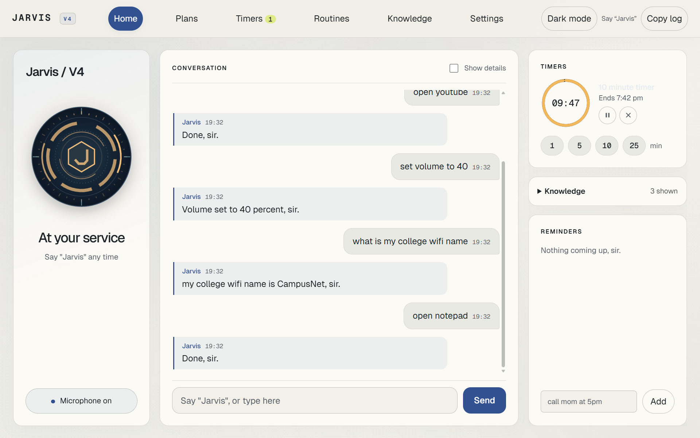<br><sub><b>Alive.</b> The reactor changes colour and motion for listening, thinking and speaking.</sub></td>
</tr>
</table>

### The reactor, in every mood

<p align="center">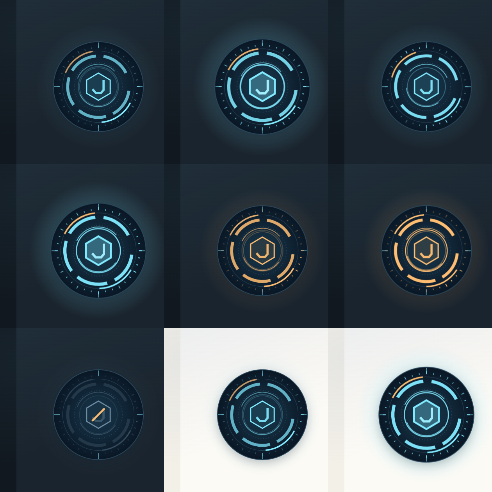</p>

### The floating pill

When the window is closed, a small always-on-top pill shows what Jarvis is doing (idle, listening, thinking, speaking). It never steals focus, hides for full-screen apps and runs at a steady 60 fps while active, 30 fps at rest.

<p align="center">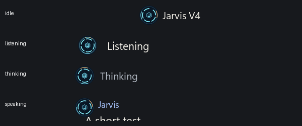</p>

---

## What you can say

| Area | Examples |
| --- | --- |
| **Apps and sites** | "Open YouTube." "Open notepad and close Edge." "Open the dashboard" (a link you saved). |
| **Timers** | "Set a timer for ten minutes." "Pause the five minute timer." "Cancel all timers." |
| **Reminders** | "Remind me to submit the assignment tomorrow at 5." "What do we have today?" "What did I miss yesterday?" |
| **Music and volume** | "Next song." "Skip two songs." "Increase your volume." "Speak slower." |
| **Windows and tabs** | "Minimise Chrome." "Close the second and third tabs." "Go to the first tab." |
| **The screen (V4)** | "Click Shorts." "Click the third video in this playlist." "Scroll down." "Number the screen", then "click 12". |
| **Messages (V4)** | "Reply to Sam that I'm running late." Jarvis writes it, reads it back, and sends only when you say "send". |
| **Multi-step jobs (V4)** | "Go to Discord, open the Gaming Hub server, and click the general channel." |
| **Memory** | "Remember my college wifi is CampusNet." "What is my college wifi name?" "Copy my email." |
| **Routines** | "When I say study mode, open notepad and set a timer." "Start study mode." "Close study mode." |
| **Corrections** | "No, I meant Chrome." "Undo that." "Do that again." |

When it is not sure, it asks: **"Which one?"** with numbered choices, rather than guessing.

---

## What makes it different

- **Offline, really.** Speech recognition, understanding, voice and memory all run locally. The code makes no calls home.
- **Rules first, AI second.** Common commands go through plain rules in milliseconds. A small local language model is only called for messy speech.
- **It tells the truth.** After acting, Jarvis reads the state back (is the tab really closed, is the timer really saved?) before it says "Done, sir." If it cannot verify, it says so.
- **Safe by design.** An allowlist of actions. Risky things (delete, send, change settings) need a spoken yes. Browser and window buttons such as "Close" are never click targets.
- **It sees the screen without screenshots.** V4 reads Windows' accessibility tree, so "click Shorts" takes tens of milliseconds, needs no vision model and sends no pixels anywhere.
- **It heals itself.** Where a site's control was is remembered, and checked before every reuse. If the page changed, Jarvis rescans and relearns instead of clicking the wrong thing.
- **It learns, but never rewrites itself.** Names, habits, routines and facts, all editable on the Knowledge page. It does not invent abilities or change its own code; wishes go to a list for its owner.
- **Cool and small.** Models unload when idle and the whole assistant fits in about 4 GB of graphics memory.

---

## How it works

<p align="center">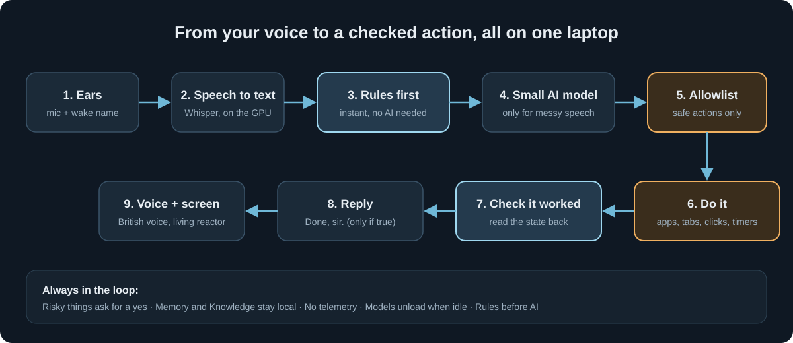</p>

1. **Ears** listen all the time for the wake name, cancel the PC's own sound (so music is not heard as commands), and cut speech into sentences.
2. **Speech to text** is Whisper large-v3-turbo on the GPU, warmed up the moment speech starts.
3. **Rules** handle the everyday commands with no AI at all.
4. **A small local AI** (a 1.5B model for choosing actions, a 4B model for answering questions) is used only when the rules do not match.
5. **The allowlist** is a registry of named abilities with typed arguments. The AI can only pick from it.
6. **The action** runs through native Windows control (windows, tabs, volume, accessibility), not blind key presses.
7. **The check** reads the result back before the reply is allowed to claim success.
8. **The reply** is short ("Done, sir.") and spoken by an offline British male voice.

---

## The story: V1 to V4

<p align="center">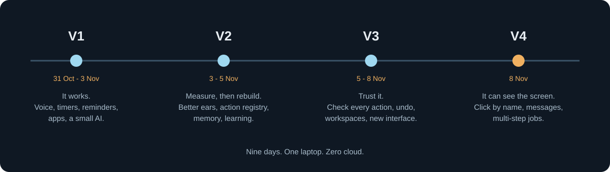</p>

| Version | Idea | Headline result |
| --- | --- | --- |
| **V1** | Make it work | Voice, timers, reminders, app control, a small AI rewriting speech into commands. Felt "hard-coded". |
| **V2** | Measure, then rebuild | Recorded real commands to find what was failing, rebuilt the ears and the decision layer around an action registry. 224 of 265 test sentences understood. |
| **V3** | Make it trustworthy | Verified actions, undo, corrections, workspaces, numbered choices, redesigned interface. Built beside V2 so the daily tool never broke. |
| **V4** | Make it see | Screen index, self-healing site memory, draft-confirm-send messages, multi-step screen tasks, a living reactor. |

Full detail: [docs/HISTORY.md](docs/HISTORY.md), the reasoning in [docs/HOW_WE_GOT_TO_V4.md](docs/HOW_WE_GOT_TO_V4.md), every bug and fix in [docs/BUGS.md](docs/BUGS.md), and a side-by-side table in [docs/FEATURES.md](docs/FEATURES.md).

---

## By the numbers

Measured on the build laptop (RTX 4070 Laptop, 8 GB). These are honest lab numbers, not marketing.

| | |
| --- | --- |
| **Understanding** | 223 to 224 of 265 labelled test sentences understood (V2 and V3); clear sentences about 85%. |
| **End of speech to action** | about 650 ms in real-time replay of recorded commands |
| **Instant commands** | 0 to 30 ms to answer |
| **Screen click** | 42 ms to scan and press on a native test window; about 0.6 s on a busy web page |
| **Memory** | about 2 GB RAM, about 3 GB graphics memory for commands, about 4 GB while a long answer is generated |
| **Heat** | models unload when idle; temperatures reported at every milestone |
| **Floating pill** | steady 60 fps active, 30 fps at rest |
| **Safety checks** | 69 silent test suites plus 75,000+ automatic parsing checks, all without sound or real apps |

---

## Privacy and safety

- No network use at runtime. No telemetry. Logs stay on the laptop.
- Future online features, if any, will need the owner's own key stored in Windows Credential Manager. They are parked, off, and "coming soon" in Settings.
- Risky actions need an explicit yes. Sending needs its own yes.
- Passwords, PINs and anything labelled secret are never read aloud, copied or fed to the chat model.
- Tests never play sound and never touch real apps or the real clipboard.

---

## Under the hood

| Part | What it uses |
| --- | --- |
| Speech to text | Whisper large-v3-turbo through faster-whisper, on the GPU |
| Action model | a 1.5B instruction model (4-bit) via llama.cpp |
| Answer model | a 4B model, loaded on demand and unloaded when idle |
| Voice | Kokoro, an offline British male voice, with a piper voice as fallback |
| Voice activity | Silero VAD |
| Window | Python, pywebview and WebView2, with local fonts and no web requests |
| Windows control | UI Automation, Win32 and pycaw for native tabs, windows, clicks and volume |
| Storage | SQLite on the laptop |

Models are **not** in this repository.

---

## Repository map

```
jarvis/        V1, kept for reference
jarvis2/       V2: action registry, ears, memory, learning, organiser
jarvis3/       V3 and V4 (V4 kept the package name)
  engine/        abilities, ears, speaker, window and web UI
  screen_index.py   V4 screen index and natural targets
  site_memory.py    V4 self-healing site memory
  engine/abilities/drafts.py   V4 draft, confirm, send
  engine/abilities/tasks.py    V4 multi-step tasks
tests/         silent self-checks (v2, v3, stress suites)
tools/         packaging and helper scripts
docs/          history, decisions, bugs, features, images
```

## Documents

| Read this | To learn |
| --- | --- |
| [docs/HISTORY.md](docs/HISTORY.md) | The full story, V1 to V4 |
| [docs/HOW_WE_GOT_TO_V4.md](docs/HOW_WE_GOT_TO_V4.md) | The key decisions, and why |
| [docs/BUGS.md](docs/BUGS.md) | Every bug and glitch, and the fix |
| [docs/FEATURES.md](docs/FEATURES.md) | V1 vs V2 vs V3 vs V4 |
| [docs/MEDIA_KIT.md](docs/MEDIA_KIT.md) | Images, captions and a promo-video storyboard |
| [V2_REBUILD_PLAN.md](V2_REBUILD_PLAN.md), [V2_CHECKLIST.md](V2_CHECKLIST.md) | The V2 plan and the feedback behind it |
| [V3_PLAN.md](V3_PLAN.md), [V3_STATUS.md](V3_STATUS.md) | V3 requirements and measured progress |
| [IMPROVEMENTS.md](IMPROVEMENTS.md) | The ten improvement areas |
| [TIER3_PICTURE_MODEL_PLAN.md](TIER3_PICTURE_MODEL_PLAN.md) | A parked plan for a picture model |
| [DEV_TESTS.md](DEV_TESTS.md), [TESTING.md](TESTING.md) | How to test by hand |
| [GOOGLE_SETUP.md](GOOGLE_SETUP.md) | Optional read-only Gmail and Calendar |

## Running it

This repository is a showcase and a record. Models, voices and personal data are deliberately left out, and a few scripts still point at the build laptop's folders, so it will not run end to end as-is. The rules engine and the silent test suites do not need the models. The launchers (`Start Jarvis V4.bat`, `Jarvis4.pyw`) show how the real app starts on Windows 11 with Python 3.12.

## Honest status

V4 is tested on one laptop. Many checks are silent and use a fake PC, so some live behaviour (noisy rooms, strong accents, every real app) is only partly proven, and the notes say exactly where. A picture model for unnamed icons is planned, but only with the owner's approval of the download.

## What comes next

- Picture model for icons that have no name (parked until approved)
- A public write-up and demo video
- More real-site testing of the screen index
- An optional online brain, always off by default and never required

---

<p align="center"><sub>Built with patience, a hot laptop and an AI that wrote every line. Private project, no licence granted.</sub></p>
